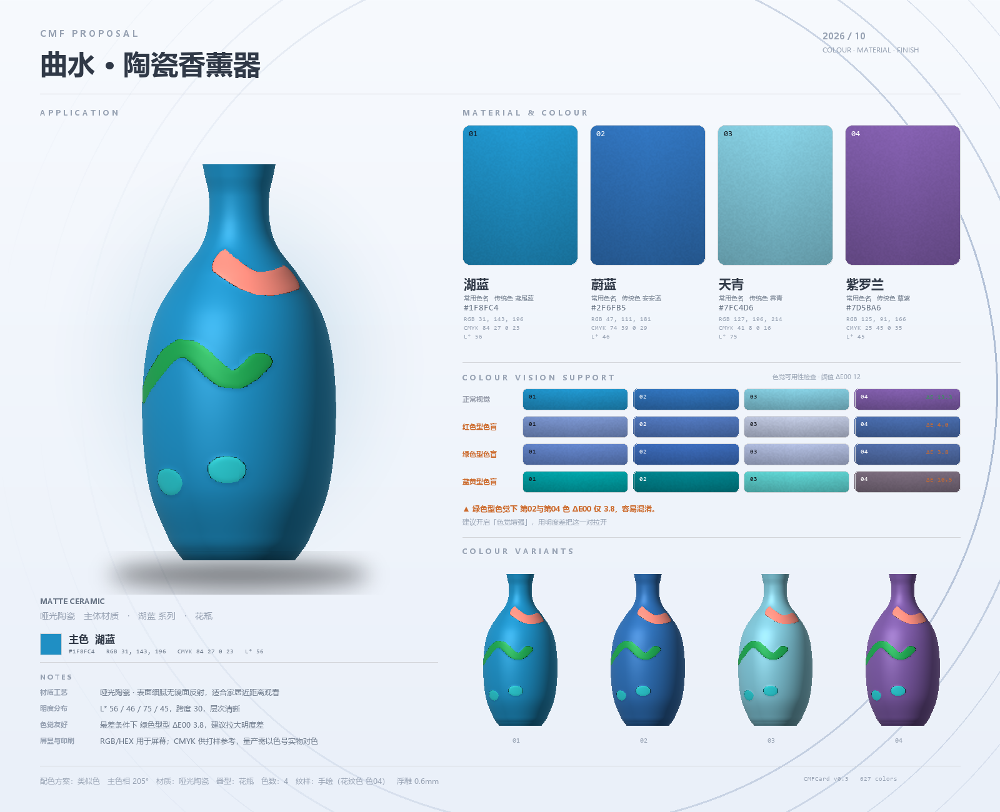
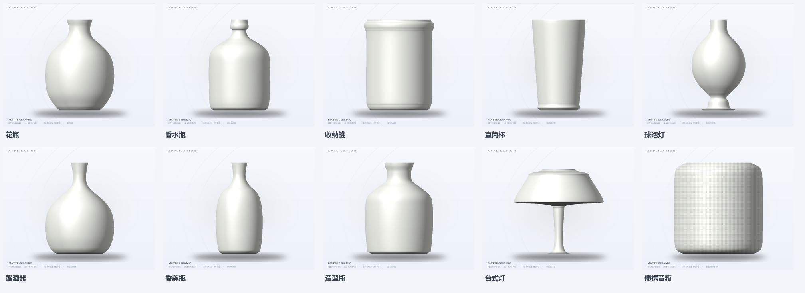
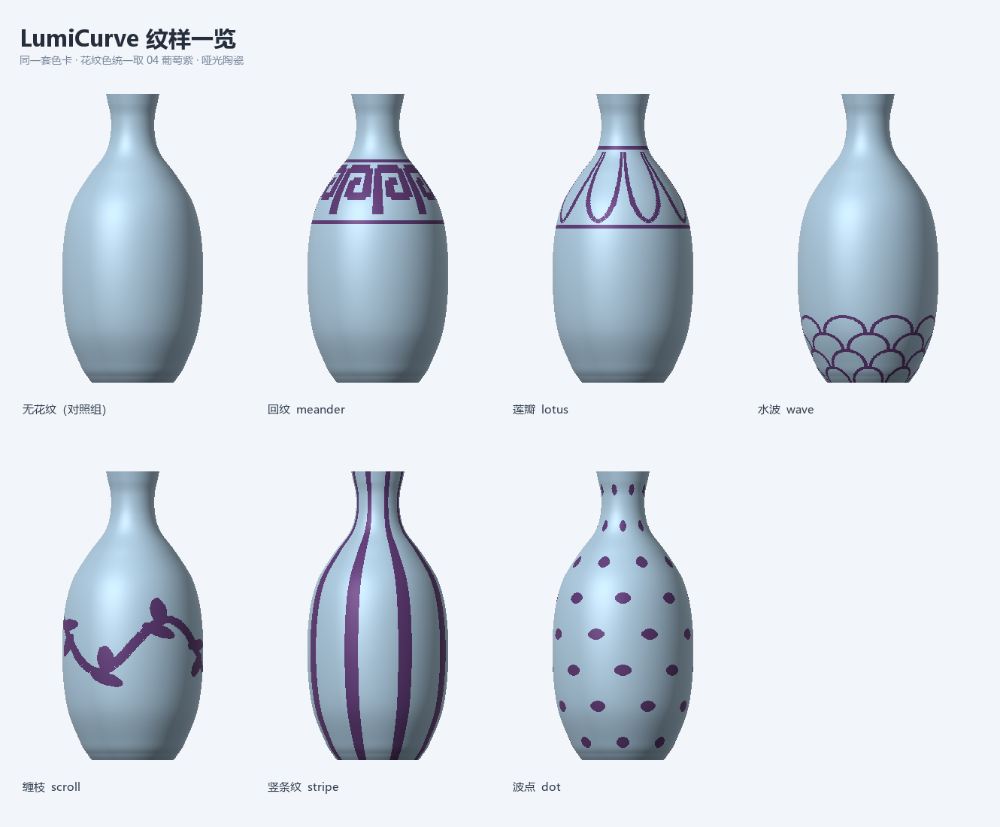
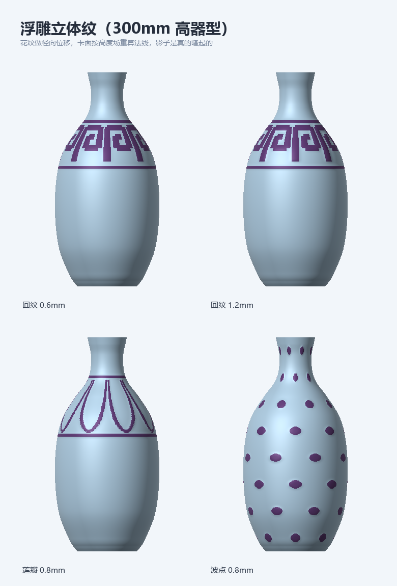

# LumiCurve — a CMF workbench for product designers

> **C**olour · **M**aterial · **F**inish, with the boring parts done properly:
> perceptual palettes, colour-vision-deficiency simulation, a live 3D preview,
> and print-ready embossed STL — all running locally in your browser.



LumiCurve is a small local web app for exploring **CMF** (Colour, Material, Finish)
options for small product forms. You pick a hue, a scheme and a shape; it generates a
palette that is *actually distinguishable* (CIEDE2000, including for colour-blind eyes),
renders the product in 3D with real PBR materials, lets you paint or stamp a pattern on it,
turns that pattern into a real embossed relief, and exports a printable STL plus a
1600 × 1300 CMF proposal card.

Built for the *AIGC Programming* course at the School of Design — and meant as a worked
example of "design tool + real maths".

---

## Highlights

| | |
|---|---|
| 🎨 **Perceptual palette engine** | sRGB ↔ linear ↔ XYZ ↔ Lab, **CIEDE2000** everywhere; palettes are snapped to a library of **526 traditional Chinese colours** + 100 common names, so a colour's *name always matches the colour* |
| 👁 **Colour-vision care** | Machado (2009) matrices for protan / deutan / tritan at any severity, ΔE00 measured *between simulated pairs*, plus a one-click search for a palette that passes |
| 🧱 **Live 3D preview** | three.js + CC0 PBR textures; surfaces of revolution built from a profile curve; four lighting setups; orbit + zoom |
| 🌸 **Pattern system** | 7 procedural motifs (meander, lotus, wave, scroll, stripe, dot…) **and** a free-hand brush that paints directly onto the mesh via raycast → UV |
| 🖨 **Emboss → STL** | the same mask becomes a height field: the outer wall is displaced radially, topology untouched, so the mesh stays watertight; export checks every edge |
| 📋 **CMF proposal card** | a 1600 × 1300 PNG with hex / RGB / CMYK / L\*, a colour-vision support panel and colour variants |

## Screenshots

| The workbench | Shapes |
|---|---|
|  |  |

| Patterns | Embossed relief |
|---|---|
|  |  |

---

## Quick start

### Option A — portable (nothing to install)

Download **`LumiCurve_portable.zip`** from the [Releases](../../releases) page,
extract it, and double-click the launcher inside. A Python runtime is bundled,
so it works on a clean Windows machine.

### Option B — from source

```bash
pip install -r requirements.txt      # numpy + pillow
python app/server.py
```

Then open <http://127.0.0.1:8770/> (the browser opens by itself).
Tested with Python 3.13 / 3.14 on Windows 11. No other dependencies — three.js and the
textures are vendored in `app/web/`, so it runs fully offline.

---

## Project structure

```
.
├── app/
│   ├── server.py          # ThreadingHTTPServer + JSON API (no framework)
│   └── web/               # single-page front-end (vanilla JS, no build step)
│       ├── index.html · style.css · app.js · view3d.js
│       ├── vendor/        # three.js r160 + OrbitControls
│       └── tex/           # CC0 PBR textures
├── cmf_color.py           # colour maths: Lab, CIEDE2000, CVD, palette snapping
├── cmf_card.py            # 2.5D renderer + CMF proposal card
├── printing.py            # shell mesh, emboss height field, binary STL, checks
├── lamp_curve.py          # Monte-Carlo luminance simulation (lamp mode)
├── cn_colors.json         # 526 traditional Chinese colours (name / hex / RGB / CMYK)
└── presets.json           # 15 curated palettes
```

## How it works (the interesting bits)

1. **Colour, honestly.** Everything runs in CIE Lab. A generated palette is
   *snapped* to the nearest library colour within a ΔE00 budget, so `#7FC4D6` is called
   *天青* only when it really is 天青 — and duplicates inside one palette are pushed apart
   by lightness instead of being renamed.
2. **Colour-vision deficiency.** Instead of guessing, the app simulates protanopia,
   deuteranopia and tritanopia (Machado 2009, severity-aware), then reports the **minimum
   ΔE00 between adjacent colours** for each type and lists the offending pairs.
3. **Geometry.** Product forms are surfaces of revolution. The profile `(y, r)` is expanded
   into a closed shell (outer wall → rim → inner wall → bottom) with a real wall thickness,
   then lathed. Lathe UVs are **rewritten so `v` means physical height** — otherwise a
   narrow neck eats half of `v` and patterns slide up into the rim.
4. **Patterns and brush.** Procedural motifs and hand-drawn strokes share one 512 × 512 UV
   mask. The brush raycasts the mesh, gets the hit's `uv`, and paints into the mask (with
   seam unwrapping so strokes wrap around the body). Strokes are RGBA: *each keeps its own
   colour*.
5. **Emboss.** The mask is blurred into a height field; only the **outer wall** vertices are
   pushed radially by `h · depth`. Topology is unchanged, so watertightness survives by
   construction. The same field drives the relief shading on the proposal card.
6. **The colour board.** 60 swatches = 12 hues × 5 lightness steps, generated in **OKLCH**;
   each swatch uses the *maximum in-gamut chroma* found by bisection, so every cell is the
   most saturated version of that hue at that lightness (HSV would not do this).

## Verified numbers

Measured, not claimed (vase, 300 mm tall, 3 mm wall, meander pattern, 0.6 mm emboss):

| | no emboss | embossed |
|---|---|---|
| triangles | 46,464 | 173,952 |
| STL size | 2.22 MB | 8.29 MB |
| volume | 326.8 cm³ | 336.1 cm³ |
| PLA mass | 405 g | 417 g |
| watertight / bad edges | ✅ / 0 | ✅ / 0 |

Re-reading the exported STL independently confirms the manifold check (260,928 edges, each
shared by exactly two triangles) and a **0.79 mm** radial spread across the pattern band
versus **0.00 mm** a few millimetres away.

## Known limitations

- Hand-drawn masks live in the browser session (and the server's memory) — they are not
  persisted to disk yet.
- The STL carries geometry only; the pattern colour lives in the CMF card, not in the mesh.
- The app is deliberately offline-first: no CDN, no telemetry, no accounts.

---

## 中文简介

LumiCurve 是一个本地运行的产品配色（CMF）工作台：拖色相盘生成配色，自动用
CIEDE2000 检查色差、模拟红/绿/蓝黄三型色盲，实时 3D 预览材质，可以在器物上手绘花纹，
把花纹做成真实的浮雕并导出可打印的 STL，最后出一张 1600×1300 的方案卡。
配色库是中国传统色 526 色 + 常用色名 100 条，取色时按 ΔE00 吸附，所以色名和颜色一定对得上。
详细使用说明见 [`docs/使用说明.md`](docs/使用说明.md)。

## Author

**曾奥哥 (Zeng Aoge)** — Product Design 262, *AIGC Programming* course, 2026
Advisor: 杨暑东

## License

[MIT](LICENSE) — the vendored three.js is MIT, the PBR textures are CC0 (Poly Haven),
and the traditional Chinese colour names are public domain.
